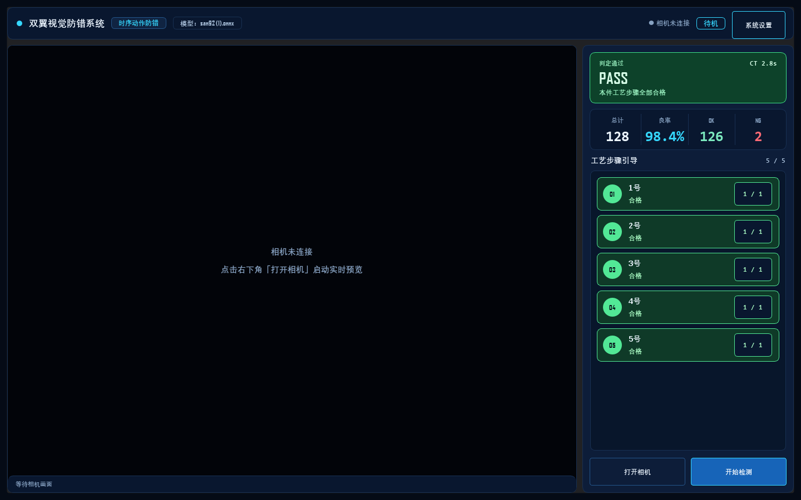
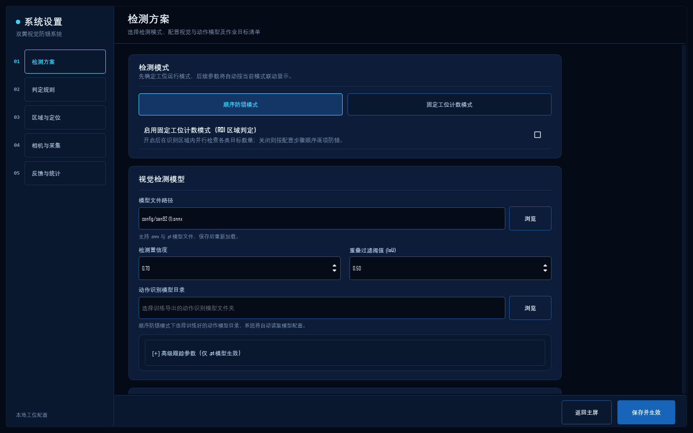

# 双翼科技工业视觉作业顺序防错系统


基于 YOLO OBB、ONNX Runtime 和 PySide6 的工业视觉边缘应用。系统面向装配、锁附等快节拍产线，通过工业相机实时检查工人是否在指定目标位置完成对应作业动作，并将模型输出的作业目标或动作点类别映射为可配置工艺步骤。

顺序状态机按照配置的 SOP 检查作业流程：符合顺序则推进步骤并记录 PASS；出现跳步、错序或未按配置步骤作业时，立即判定 FAIL，触发声音提醒、保存现场证据并记录生产统计。

当前公开演示模型默认使用 1号 到 5号 作为工艺步骤标签。这不是固定业务限制；类别名称、步骤数量、步骤顺序和检测目标都可以通过配置和更换模型调整，适配不同工装、孔位、动作点或作业流程。

本仓库为完整工程交付版本，包含产线桌面检测端（`yolo_action_detection`）、配套 Web 统一标注与训练工作台（`lstm_workbench`）、自动化测试套件、正式文档与便携打包脚本；不包含本机私有配置、业务数据集与过程草稿。

## 项目展示

### 实际运行演示

[](yolo_action_detection/assets/demo/action-detection-demo.mp4)

点击上方动图可打开高清 MP4 演示视频。

### 主检测界面



### 配置与生产统计



## 解决的问题

在产线装配中，作业节拍快、人工很难持续确认每个工人是否严格按 SOP 顺序操作。该系统将视觉检测结果转化为工艺步骤状态，形成实时防错闭环：

- 作业目标检测：识别当前画面中被操作的目标位置、动作点或工艺步骤类别。
- 工艺顺序校验：按配置步骤逐项推进，确认工人是否按指定顺序作业。
- 固定工位数量检测：搜索 ROI 内边缘模板定位触发一轮，在识别 ROI 内并行判定多个平级类别和数量。
- 错序防呆：首步启动后，后续跳步、错序达到 NG 稳定帧立即 FAIL。
- 现场追溯：NG 时保存证据图片和 metadata。
- 生产统计：统计总数、OK、NG、良率，并支持手动归零归档。
- 交付部署：PyInstaller 打包后可复制到无 Python 的目标电脑运行。

## 核心能力

| 模块 | 能力 |
| --- | --- |
| 实时采集 | 支持工业相机 SDK 和 OpenCV 采集链路 |
| 模型推理 | 使用 ONNX YOLO OBB 模型检测可配置的作业目标或动作点类别 |
| 顺序判定 | 将模型类别映射为工艺步骤，使用状态机校验 SOP 顺序 |
| 结果反馈 | PASS / FAIL 独立声音提示，FAIL 证据图片保存 |
| 生产统计 | 总数、OK、NG、良率展示，归零时生成统计记录 |
| 配置中心 | 模型路径、类别名称、步骤顺序、稳定帧、声音、证据、相机参数可配置 |
| 便携交付 | PyInstaller 打包，目标电脑无需安装 Python |

## 系统架构

    工业相机 / OpenCV
          |
          v
    CameraWorker 实时采集
          |
          v
    ONNX OBB Processor 作业目标或动作点检测
          |
          v
    StepSequenceEngine 工艺顺序状态机
          |
          +--> PySide6 主界面状态刷新
          +--> PASS / FAIL 声音反馈
          +--> FAIL 证据保存
          +--> ProductionStats 生产统计归档

    ROI 模式：EdgeTemplateModel 搜索 ROI 定位门控
          -> RoiInspectionEngine 单帧触发与分类别数量锁存
          +--> 同一套 PASS / FAIL、证据和生产统计

## 技术栈

| 分类 | 技术 |
| --- | --- |
| 语言 | Python 3.11 |
| 桌面 UI | PySide6 + PyQtDarkTheme 2.1.0（MIT） |
| 视觉处理 | OpenCV |
| 推理引擎 | ONNX Runtime |
| 检测模型 | YOLO OBB |
| 工业相机 | MvSDK 封装 |
| 打包 | PyInstaller |
| 配置与记录 | JSON |

## 工程亮点

### 1. 模型类别可配置为工艺步骤输入

模型不再依赖特定工具与位置交集规则，而是直接输出当前画面命中的作业目标或动作点类别。状态机只关注该类别是否匹配当前配置步骤，因此同一套软件可以通过更换模型和配置，适配不同产品、工装、孔位和作业流程。

### 2. 适合快节拍产线的 PASS / NG 稳定策略

PASS 和 NG 使用独立稳定帧配置。默认 PASS 1 帧、NG 2 帧，减少快速动作下的漏判，同时避免单帧抖动导致误报警。

### 3. 第 1 步 PASS 后才允许 NG

新一轮必须先完成第 1 步，才会允许后续步骤触发错序 NG。这样可以过滤上一件产品残影、模型短暂误输出和画面噪声。

### 4. 终止式 NG 和自动下一轮

检测到错序 NG 后，当前产品立即结束并记录 FAIL，系统自动进入下一轮第 1 步等待。重新检测到第 1 步后才允许下一次 NG，避免同一错误动作连续刷多次 FAIL。

### 5. 生产统计批次归档

开始检测、停止检测和关闭相机都不会清零统计。只有配置页的“归零并保存记录”会先写入生产记录，再清零并开启新批次，符合真实生产场景。

### 6. 便携部署

打包目录包含模型、配置、声音和运行依赖。目标电脑只需要相机驱动，复制目录后即可双击运行。

便携目录同时提供 `diagnose.bat`。目标电脑无法开始检测时运行该脚本，程序会实际加载 ONNX 处理器，并在 `logs\startup_diagnostics.log` 记录配置来源、模型路径和 SHA256、ONNX Runtime/provider、相机与推理错误及完整异常堆栈；`logs\portable_smoke_test.log` 保存便携自检摘要。将这两个文件复制回来即可定位模型缺失、绝对路径失效、运行库/DLL、模型损坏或推理异常。正常启动不计算完整模型哈希，不增加这部分启动等待。

### 7. 工业 HMI 界面升级与开源控件主题

界面采用 MIT 许可的 PyQtDarkTheme 管理 PySide6 标准控件，并按产线 HMI 规范完成布局与术语升级：主界面提供顶部设备/模型状态栏、右侧醒目 PASS/FAIL Hero 状态横幅、四色生产统计卡片与固定底部遥测栏；系统设置重构为 5 大功能分组（检测方案、判定规则、区域与定位、相机与采集、反馈与统计），支持未保存修改提示与 ROI 65%/35% 左右分栏编辑。

### 8. 低核工控机（含 i3-7100）CPU 降载与防卡顿

针对产线常见 2 核 4 线程 CPU 持续满载导致界面卡顿的问题，运行时内置通用降载策略：

- **自动线程预算与去自旋**：ONNX Runtime 自动按逻辑核心数一半（上限 4，i3-7100 限为 2 线程）分配 `intra_op_num_threads`，`inter_op_num_threads = 1`，默认关闭线程池自旋等待（`allow_spinning = 0`），并同步限制 OpenCV 内部线程数。
- **推理节流与最小冷却**：推理线程默认限频 `10 FPS`，且单帧超时后仍强制让出 `25 ms` 冷却窗口（停止检测时可中断立即唤醒），防止主线程与 UI 饥饿。
- **手部模型按需启用与预览降频**：未启用含手部特征的动作模型时完全不加载 MediaPipe Hands，视频预览刷新优化为 `20 FPS`。

## 项目结构

| 路径 | 说明 |
| --- | --- |
| yolo_action_detection/src/main.py | 产线端程序入口、线程预算与便携路径初始化 |
| yolo_action_detection/src/ui | PySide6 工业 HMI 主界面、5 分组配置中心与开源控件主题 |
| yolo_action_detection/src/camera | 相机采集、MvSDK 封装、节流推理线程与背压控制 |
| yolo_action_detection/src/yolo_runtime | YOLO OBB / ONNX Runtime 推理与线程防自旋配置 |
| yolo_action_detection/src/step_sequence | 工艺步骤顺序状态机 |
| yolo_action_detection/src/template_matching | 搜索 ROI 内固定比例、多角度边缘模板定位 |
| yolo_action_detection/src/roi_inspection | 识别 ROI 几何、单帧定位触发和分类别轮次引擎 |
| yolo_action_detection/src/detection_logging | 声音反馈、FAIL 证据与生产统计归档 |
| yolo_action_detection/config | 示例配置（`config.example.json`）与演示 ONNX 模型 |
| yolo_action_detection/assets | PASS / FAIL 声音、界面截图与演示素材 |
| yolo_action_detection/packaging | PyInstaller 便携打包脚本与自检工具 |
| yolo_action_detection/tests | 产线端单元测试与 UI / 运行时回归套件 |
| lstm_workbench | 配套本机/内网 Web 统一标注与训练工作台（YOLO OBB + 因果 LSTM） |
| docs/统一训练工作台设计.md | 统一训练工作台架构与设计边界文档 |

## 快速启动

源码运行：

    cd yolo_action_detection
    ..\.venv\Scripts\python.exe src\main.py

便携打包：

    cd yolo_action_detection
    .\packaging\build_yolo.bat

打包输出：

    yolo_action_detection/dist/YOLOActionDetection

目标电脑需要安装相机驱动。复制打包目录后，双击 YOLOActionDetection.exe 或 start.bat 启动。

## 标注与训练工作台（YOLO OBB + 因果 LSTM）

仓库中的 [lstm_workbench](lstm_workbench/README.md) 是与产线程序配套的**本机/内网 Web 统一训练工作台**，覆盖从数据生产到模型交付的完整闭环：

- **双阶段统一工程**：同一工程内打通「零件检测（YOLO OBB）→ 模型库 ONNX 导出 → 动作时序分类（因果双层 LSTM + Part Gate 必检零件门控）」，并通过 `sync_station.py` 与产线工位复用同源推理代码。
- **高效数据接入与原生标注**：支持粘贴 `ul://` 平台命令自动拆解 API Key、拉取并打包生成标准 `.zip`；支持内网网线直连浏览器分块上传图片/视频/ZIP；内置原生 Canvas OBB 旋转框编辑器、4 态审核门禁与按 `source_group` 整组防泄漏发布。
- **官方级训练诊断与回流**：实时展示 4 宫格训练曲线与 ETA、Ultralytics 官方全套图表画廊（混淆矩阵、PR/F1 曲线、标签分布、验证集真值 vs 预测并排对照 + 高清缩放灯箱）、PT/ONNX 同样本对照与错例一键回流。
- **内网安全与离线交付**：后端按 `routes/` + `workbench.py` + `lan_auth.py` 模块化分层；支持主机一键开启局域网访问口令（PIN）与内网只读模式；通过 `make_offline_runtime.py` 打包独立 Python + CUDA `runtime/` 实现离线交付。

详细介绍、架构图与消融数据见 [工作台完整说明](lstm_workbench/README.md)，部署与运行见 [训练台部署说明](lstm_workbench/部署说明.md)，架构设计见 [统一训练工作台设计](docs/统一训练工作台设计.md)。

开发环境启动：

```bat
.venv\Scripts\python.exe -m lstm_workbench
```

工作台默认本机地址为 [本机训练台](http://127.0.0.1:8771/)，同时自动打印局域网访问网址（可加 `--lan-pin <口令>`、`--lan-readonly` 或 `--local` 控制内网策略）。训练数据和实际工程的审核结论需要人工复核，测试检测器通过不等于真实产线模型精度已经验证。

## 关键配置

| 配置项 | 说明 |
| --- | --- |
| yolo_model_path | ONNX / YOLO 模型路径 |
| category_names | 工艺步骤类别名称和顺序，演示默认 1号 到 5号，可随模型调整 |
| roi_inspection_enabled | 是否启用固定工位 ROI 定位检测 |
| roi_template_enabled | 是否启用边缘模板定位门控 |
| roi_template_rect / roi_template_search_rect | 创建模板 ROI 和运行时搜索 ROI |
| roi_inspection_rect | 归一化识别 ROI |
| action_pass_stable_frames | PASS 稳定帧 |
| action_ng_stable_frames | NG 稳定帧 |
| action_order_constraint_enabled | 是否启用错序 NG |
| pass_sound_enabled | 是否启用 PASS 提示音，默认关闭 |
| fail_sound_enabled | 是否启用 FAIL 提示音，默认开启 |
| sound_feedback_enabled | 旧版兼容字段，保存时同步为 FAIL 提示音开关 |
| fail_evidence_enabled | 是否保存 FAIL 证据图片 |

## 输出与记录

| 输出 | 路径 |
| --- | --- |
| FAIL 证据图片 | yolo_action_detection/outputs/evidence |
| 生产统计记录 | yolo_action_detection/outputs/production_records |
| 便携 smoke 日志 | dist/YOLOActionDetection/logs |

## 验证

发布前已完成以下验证：

- 产线端核心运行时、ONNX 线程预算/去自旋、手部按需开关与工业 HMI 界面回归测试：通过
- 便携版 `YOLOActionDetection.exe --portable-smoke-test` ONNX 模型加载自检：通过
- 模型路径、声音资源与证据目录校验：通过

## 分支说明

| 分支 | 说明 |
| --- | --- |
| main | 正式版本（产线检测端 + 统一标注训练工作台） |
| feature/mediapipe-hands-overlay | 功能开发分支（与 `main` 同步） |
| google | Google / MediaPipe 早期原型归档分支 |

## 求职展示重点

这个项目展示的不是单纯的模型分类或推理调用，而是一个完整的工业视觉现场工具：

- 作业目标与动作点检测建模
- ONNX Runtime 实时推理链路
- SOP 工艺顺序状态机
- 工业相机适配
- 桌面 UI 设计
- 现场配置能力
- 证据追溯
- 生产统计
- 便携部署

适合用于展示计算机视觉、桌面客户端、生产现场工具和工程交付能力。
