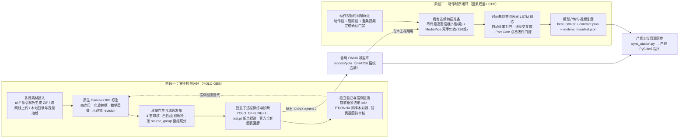

# 工业视觉双阶段统一训练工作台（YOLO OBB + 因果 LSTM）


面向工业装配、锁附等产线场景的一体化**数据生产、标注审核、模型训练、验证回流与离线部署**本机 Web 工作台。

一个工程同时打通 **空间零件检测（YOLO OBB）** 与 **时序动作识别（因果双层 LSTM）** 两条流水线，覆盖从 `ul://` 云端拉取 / 网线跨机推送素材，到 OBB 旋转框审核、冻结数据版本、训练曲线与官方图表诊断、错例回流，再到动作视频特征缓存、时序建模与产线工位同源部署的完整工程闭环。

---

## 系统架构与数据闭环



---

## 核心工程亮点

### 1. 严格的反数据泄漏与全链路指纹追溯
- **来源组隔离切分**：所有零件素材强制绑定 `source_group`（同一条视频或同一次拍摄批次），发布时以来源组为原子单位划分 `train / val / test`，避免同视频相邻帧同时出现在训练集和验证集导致的虚高指标。
- **不可变数据快照**：发布生成冻结目录 `parts/versions/<version_id>/`，记录类别顺序与内容 SHA256 哈希；后续继续在工作区标注不会篡改正在训练或历史轮次的输入数据。
- **训练与导出强绑定**：每轮记录数据快照、底模与权重 SHA256，PT 与 ONNX 对照前校验 `best.pt` 源指纹，防止“模型与导出文件错配”。

### 2. 双阶段标签质量门禁
- **零件审核 4 态分离**：明确区分 `unlabeled`（未标注）、`pending`（草稿/模型预标注待审核）、`reviewed`（人工已审核）和 `negative`（显式确认无目标负样本），空标签绝不自动充当负样本，预标注结果必须人工审核后才能进入发布集。
- **动作视频完成确认门禁**：未勾选“已检查整条视频，未涂区间确认为空闲”的视频可提前后台抽特征，但会被阻断进入动作训练；一旦修改标注区间或剔除段，自动撤销完成确认，防止半标视频污染空闲类。

### 3. 真实业务消融验证与产线一致性保障
- **训练与工位同源推理**：通过 [sync_station.py](sync_station.py) 将产线端的 `onnx_obb_processor` 与 `mediapipe_hands` 同步到工作台，确保离线抽特征与产线实时推理零偏差。
- **时间基自动换算（`time_base`）**：窗口按秒定义、由视频帧率自动换算帧数，不同帧率相机采集的视频无需硬编码重采样常量。
- **Part Gate 必检零件门控**：从训练集自动统计每类动作稳定出现的必检零件（帧占比 $\ge 20\%$ 且段占比 $\ge 50\%$），推理复盘时若动作段缺失必检零件直接拦截，显著压低纯时序误报。
- **真实数据正则化消融对照**（同划分、200 轮训练，详见 [trainer.py](trainer.py)）：

| 训练策略配置 | 逐帧准确率 | 空闲误报率 | 工程结论 |
| --- | --- | --- | --- |
| 基线（无梯度裁剪 / 无权重衰减） | `0.922` | `0.104` | 空闲帧误触发偏高 |
| 梯度裁剪 `GRAD_CLIP=0.25` | `0.931` | `0.046` | 空闲误报下降 **55.8%** |
| 梯度裁剪 `0.25` + 权重衰减 `1e-4` | `0.929` | `0.046` | 第 87 轮即收敛至最优，泛化更稳 |

### 4. 单机高并发协调与多层次安全防护
- **读写锁与 GPU 互斥分离**：全局 `_gpu_lock` 串行协调 YOLO 训练、验证/预标注、后台特征准备与 LSTM 训练；工程级 `_data_locks` 仅保护 JSON/清单读写，长训练期间仍可流畅保存标注。
- **三层 HTTP 安全守卫**：
  1. **防 DNS 重绑定与跨站请求**：校验 `Host` 与 `Origin` 白名单（拦截公网域名）、不开放 CORS、写操作要求 `application/json` 或自定义 `X-Filename` 触发预检拦截；
  2. **内网轻量口令保护（PIN）**：本机（`127.0.0.1`）免密且独占安全策略配置权，可一键设置 4–32 位 PIN（PBKDF2-SHA256 加盐哈希落盘，下发 `HttpOnly; SameSite=Strict` HMAC 会话 Cookie，含防暴力频控）；
  3. **内网只读模式**：本机可随时开启，允许局域网设备浏览训练曲线、官方图表与下载数据集 ZIP，同时拦截远端所有修改、删除与任务启停请求。
- **离线便携与跨机协作**：支持粘贴 `ul://` 平台命令自动拆解 API Key、拉取并生成标准 `.zip` 数据包；支持网线直连打开内网网址分块流式上传大视频/图片集；支持 `make_offline_runtime.py` 打包独立 Python 3.11 + CUDA `runtime/` 实现零环境安装交付。

---

## 模块化代码架构

```text
lstm_workbench/
├── app.py                      # HTTP 服务装配入口、三层请求守卫、鉴权路由与启动横幅
├── workbench.py                # 全局协调器：GPU 互斥锁、工程数据锁、后台准备与传输调度
├── http_utils.py               # Host/Origin 校验、Range 断点解析、局域网 IP 探测
├── lan_auth.py                 # 内网轻量安全：PBKDF2 PIN 口令、HMAC Cookie、只读策略与频控
├── routes/                     # HTTP 业务路由分层
│   ├── media.py                #   视频/图片 Range 流式传输、分块上传、连续图收编
│   ├── parts.py                #   零件素材、原生 OBB 标注、审核、质检、发布与跨机上传
│   ├── yolo.py                 #   YOLO 训练/续训、官方图表文件、ONNX 导出、验证与预标注
│   └── action.py               #   LSTM 模型探测、划分确认、特征抽取、动作训练与视频复盘
├── dataset_transfer.py         # ul:// 命令智能解析、平台鉴权、并发拉取、ZIP 打包与异步进度
├── parts_store.py              # 零件工作区存储、四点凸边形校验、来源组隔离与不可变快照
├── yolo_jobs.py                # Ultralytics 独立子进程训练、last.pt 续训、官方图表枚举与导出
├── yolo_validation.py          # 旋转框多边形 IoU 评估、PT/ONNX 同样本对照与错例回流
├── yolo_validation_worker.py   # 独立推理子进程与逐张进度回写
├── service.py / trainer.py     # 动作完成确认门禁、时间基对齐与双层因果 LSTM 训练循环
├── model.py / part_gate.py     # ActionLSTM 网络定义与必检零件门控
├── features.py / extract.py    # 零件框 + MediaPipe 手部 21 点特征编码与中文路径图像解码
├── feature_store.py / preparation.py  # 逐视频连续特征缓存与后台排队准备线程
├── model_registry.py           # 全局模型库、SHA256 指纹与手部模型后台预热
├── static/                     # 零构建前端（原生 JS + Bootstrap + ECharts + Canvas OBB 编辑器）
└── tests/                      # 310+ 项 Python 自动化回归 + Node 前端几何/竞态测试
```

---

## 快速启动与内网协作

### 1. 日常启动（默认开启本机 + 内网监听）
```bat
:: 方式一：离线电脑或开发机直接双击
lstm_workbench\启动训练台.bat

:: 方式二：命令行启动（仓库根目录）
.venv\Scripts\python.exe -m lstm_workbench
```
启动后控制台会打印本机地址（`http://127.0.0.1:8771/`）与自动探测到的局域网地址（如 `http://192.168.1.99:8771/`），页面右上角可直接点击复制内网网址。

### 2. 安全启动参数与防火墙放行
- **开启内网访问口令（PIN）**：`python -m lstm_workbench --lan-pin 246810`（或本机打开网页右上角内网按钮一键配置/随机生成 6 位口令）
- **开启内网只读模式**：`python -m lstm_workbench --lan-readonly`（也可在本机网页实时切换）
- **仅限本机回环访问**：`python -m lstm_workbench --local`
- **跨电脑访问防火墙放行**：首次需要网线直连/局域网其他电脑访问时，在主机双击运行一次 [放行内网端口.bat](放行内网端口.bat)。

### 3. 运行完整自动化测试
```bat
:: Python 后端与 API 回归测试
.venv\Scripts\python.exe -m pytest lstm_workbench/tests -q --disable-warnings

:: 前端 OBB 几何、防竞态与并发保存测试
node lstm_workbench/tests/test_parts_flow.js
node lstm_workbench/tests/test_obb_editor.js
node lstm_workbench/tests/test_annotation_save.js
```

> 更多离线部署、升级备份与 `runtime/` 打包步骤请参阅 [部署说明.md](部署说明.md)。
